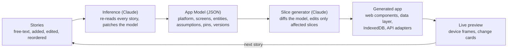

# Story to Code: PRD

Draft, 2026-10-19. Gap review applied 2026-10-19. Living version: [Claude Doc](https://claude.ai/code/artifact/af80869b-9c2e-4e1a-9036-372f81b3c6f4).

## Overview

Story to Code turns plain-language user stories into a running app that re-shapes itself after every story. A person types "Joe logs into an app" and sees a phone frame with a login screen within seconds. Each new or edited story makes Claude re-infer the app: its platform, screens, components, data model and integrations.

The surprise is the product. A story that changes the app's identity ("Sally is at the store", "this should be a game on the App Store") should visibly transform it, and the person should see why.

The output is real code, not a mock-up: HTML5 and vanilla JavaScript web components, built in vertical slices so every story adds a working path from UI to data.

## Goals and non-goals

The first release proves one thing: a sequence of stories reliably produces a running, coherent app that changes in ways the person can follow.

**Goals**

- A first visible app within one story, starting from a generic shell (login screen on a phone frame).
- Every story change triggers a re-inference and a fresh render, with a diff of what changed and which story caused it.
- The generated app is runnable HTML5 + vanilla JS web components with no framework or build step.
- The UI and the data model are both inferred, and both stay traceable to the stories that implied them.
- Projects can be exported as a plain folder or Git repository.

**Non-goals for v1**

- Producing App Store binaries or native Swift/Kotlin code (see Platform inference).
- Hosting or operating the generated apps in production.
- Multi-user collaborative editing of the same story set.
- Pixel-perfect visual design; wireframe fidelity first, styled later.

## Users and the core loop

The primary user is someone with an app idea who thinks in scenarios, not specs: a founder, product manager, designer or hobbyist. A secondary user is a developer who wants a working scaffold to take over.

The screen has two halves: a story list on the left and a live device preview on the right (phone, tablet, desktop or a combination, as inferred).

The loop, repeated for every story:

1. The person adds, edits, reorders or deletes a story in plain language.
2. Claude re-reads the whole story set and updates the **App Model**: platform, personas, screens, components, entities, integrations and assumptions.
3. Claude plans the smallest vertical slice that satisfies the new or changed story.
4. Claude generates or edits the affected web components and data layer.
5. The preview hot-swaps to the new app, and a change card explains what changed and why ("Added a Store entity and a store-mode screen because Sally is at the store").
6. The person reacts: accepts, pins something they want kept, or writes the next story.

The person can also pin decisions ("keep it a web app") so later stories cannot overturn them, and roll back to any earlier version.

Around the two halves sit four smaller panes, each reachable in one click:

- **Assumptions**: every guess Claude has made, with its confidence and the story behind it; confirm, reject or pin each one.
- **Changes**: the change cards in order, newest first, with pivots badged.
- **Versions**: a timeline of every version; click one to view it in the preview, roll back to it, or diff it against the current version.
- **Settings**: the Claude API key, provider keys, the wild/steady dial and export.

## Stories and precedence

Stories are an ordered list, and the order carries meaning.

- Every story gets a stable id when it is created. Editing or moving a story keeps the id, so traces and change cards survive rewording and reordering.
- When two stories conflict, the one lower in the list wins. New stories are appended, so by default the newest story wins; dragging a story up or down changes which one wins. A pinned decision beats both. This is the rule FR-7 refers to.
- A disabled story stays in the list but is skipped by inference, so the person can see what the app looks like without it and re-enable it later.
- A story that lost a conflict is marked superseded in the list, naming the story that overrode it. It is not deleted; moving it below the winner makes it win again.
- Deleting a story can be undone until the next change, and the deletion is recorded in history like any other change.
- Personas are inferred from names: the first "Joe" creates a persona and later stories about Joe attach to it. A story that only describes a persona ("Joe is a store manager") adds a fact to that persona and produces no screen.
- A story too vague to change the app ("Joe is happy") produces no slice. The change card says so and suggests what the story could add (a place, a device, an action, a thing Joe wants). An off-topic first story ("hello") yields the generic shell with a low-confidence assumption. A story the app already satisfies produces a no-op card naming the artifacts that cover it.
- Limits: a story is at most 2,000 characters and a project at most 200 stories in v1. Beyond that the tool asks the person to split the project.
- Deleting a story removes the artifacts only it implied. An artifact that a later story also depends on stays, and its trace is updated to the remaining stories.

## Worked examples

These two sequences are the acceptance scenarios for v1. Each row is one story and what the app must become after it.

**Open-ended: Joe and Sally**

| # | Story | What Claude infers | What the preview shows |
| --- | --- | --- | --- |
| 1 | Joe logs into an app. | Generic app, one persona, auth needed. Default platform: mobile. | Phone frame, login screen, empty home. |
| 2 | Joe is sitting at his desk using his desktop. | It is a web app; responsive with a desktop layout. | Phone and desktop frames side by side; desktop gets a sidebar layout. |
| 3 | Sally uses the same app and is at the store. | Second persona; a Store concept; a reason to use it at home and in store (e.g. lists or inventory). | Store entity, a store-context screen, a guess at the domain shown as an assumption the person can confirm or reject. |

**Focused: Susie's weather app**

| # | Story | What Claude infers | What the preview shows |
| --- | --- | --- | --- |
| 1 | Susie picks up her phone to check the weather. | Weather app, mobile-first. | Phone frame, weather home with placeholder data. |
| 2 | Susie checks the weather and the app shows the local weather. | Needs geolocation and a weather API; Location and Forecast entities. | Live local conditions via the browser Geolocation API and a weather service. |
| 3 | Susie wants to see the weather in Florida tomorrow. | Place search, saved locations, multi-day forecast; local stays primary. | Search, a saved-places list, a day picker; local card remains on top. |
| 4 | This app should be a game, and I want it on the App Store. | Identity shift to a game; target is iOS native distribution. | A game-shaped UI following Apple's Human Interface Guidelines, plus an App Store readiness checklist (see Platform inference). |

## Functional requirements

**Stories**

- [ ] FR-1 Add, edit, reorder, delete and disable stories in free text; no template required.
- [ ] FR-2 Accept optional structured form ("As a…, I want…, so that…") and acceptance criteria, but never require it.
- [ ] FR-3 Each story shows which screens, components and entities it produced (story-to-artifact trace).

**Inference**

- [ ] FR-4 Maintain one App Model (JSON) as the single source of truth, regenerated or patched after each story change.
- [ ] FR-5 Infer platform, personas, screens and navigation, components, entities and relationships, integrations, and non-functional needs (offline, auth, location).
- [ ] FR-6 Record every guess as an explicit assumption with a confidence level; the person can confirm, reject or pin it.
- [ ] FR-7 When stories conflict, the story lower in the list wins (by default the newest) unless the earlier decision is pinned, and the change card says so.

**Generation and preview**

- [ ] FR-8 Generate HTML5 + vanilla JS custom elements (Shadow DOM, no framework, no build step).
- [ ] FR-9 Render the app in device frames chosen from the inferred platforms; update in place without a page reload where possible.
- [ ] FR-10 Offer a wireframe mode (grayscale, boxes and labels) and a styled mode.
- [ ] FR-11 Generate a data layer from the entities: a typed store with IndexedDB persistence and seed data, with adapters for external APIs.
- [ ] FR-12 Mock any external service until the person supplies a key or picks a provider.

**History and export**

- [ ] FR-13 Version every App Model and code snapshot; diff and roll back between any two versions.
- [ ] FR-14 Export the app as a folder or push it to a Git repository, with the stories and App Model included.

**Control and feedback**

- [ ] FR-15 An Assumptions panel lists every open assumption with its confidence and source story; rejecting one re-runs inference with the rejection as a constraint.
- [ ] FR-16 Every change produces a change card: the stories that caused it, a summary of the model diff, the files touched, new assumptions, a pivot flag when the app's identity changed, and a one-click rollback.
- [ ] FR-17 A story edit made while a change is in flight cancels that change and restarts after a short debounce; the preview keeps the last good version until the new one is ready.
- [ ] FR-18 Failures never blank the preview. When Claude is unreachable, returns an invalid model, or generated code throws, the last good version stays up and an error card explains and offers retry.
- [ ] FR-19 Settings hold the Claude API key, provider keys and the wild/steady dial. Keys are never written into generated code, exports or the App Model.

## Non-functional requirements

| Area | Target for v1 |
| --- | --- |
| Latency | A progress indicator appears within 200 ms of a story change, the change card within a few seconds, and the preview updates within 10 seconds for story sets under 20 stories. The model patch streams first so the card can show before code finishes. |
| Cost | One story change re-reads the story set once (cached) and regenerates only affected slices. Settings show the project's token spend to date. |
| Determinism | The same story set, pins and dial setting produce the same screens, components and entities (names and structure), even if wording in generated code differs. Achieved by patching the model rather than regenerating it, and low sampling temperature. |
| Browser support | The tool and generated apps run in the current versions of Chrome, Safari, Firefox and Edge. Generated apps need only custom elements, Shadow DOM, ES modules and IndexedDB, all baseline features. |
| Accessibility | The tool meets WCAG 2.2 AA, including keyboard reordering of stories and focus kept in place when the preview hot-swaps. Generated components use semantic HTML, labelled controls, keyboard focus order and visible focus; wireframe mode keeps readable contrast. |
| Security | The preview runs in a sandboxed iframe on its own origin. Keys are stored by the tool only, outside generated code, and every generated file and export is scanned for key-shaped literals before it is written. Generated code is linted before it is loaded. |
| Privacy | Stories and the App Model are sent to the Claude API and stored where the tool runs (see Open questions). Settings state this plainly and link to the API data retention terms. No story content leaves the tool for telemetry without opt-in. |
| Size | A generated app loads from static files with no bundler; the shell and store together stay under a few hundred kilobytes uncompressed. |

## Architecture

Claude is the engine at two points: inferring the App Model from the stories, and generating code from changes to that model. Everything else is deterministic plumbing.



The App Model is the hinge: stories change the model, the model's diff drives the code, and the preview closes the loop back to the person.

- **Claude calls** use the Messages API with structured output (tool use) for the App Model, and prompt caching for the story set and component library.
- **Generated app** is plain files: `index.html`, one module per custom element, a `store.js` data layer, and a `manifest.json` when a PWA is inferred.
- **Preview** runs the generated app in a sandboxed iframe inside device frames, swapping modules in place on each change.

## App Model schema

The App Model is one JSON document with a versioned schema. Every artifact in it carries the ids of the stories that implied it, which is what makes the trace in FR-3 and the change cards possible.

```json
{
  "schemaVersion": 1,
  "meta": { "name": "Weather", "summary": "Local and remote weather for Susie", "dial": "steady" },
  "platform": { "primary": "mobile", "targets": ["mobile"], "distribution": "web", "stories": ["s1"] },
  "personas": [{ "id": "susie", "name": "Susie", "facts": [], "stories": ["s1"] }],
  "screens": [
    { "id": "home", "name": "Weather home", "route": "/", "persona": "susie",
      "components": ["weather-card", "place-search"], "stories": ["s1", "s2", "s3"] }
  ],
  "navigation": { "kind": "stack", "start": "home", "links": [] },
  "components": [
    { "tag": "weather-card", "purpose": "Shows conditions for one location",
      "attributes": ["location-id", "day"], "events": ["refresh"], "stories": ["s2"] }
  ],
  "entities": [
    { "name": "Location", "fields": { "id": "string", "name": "string", "lat": "number", "lon": "number", "isLocal": "boolean" },
      "relations": [], "stories": ["s2", "s3"] },
    { "name": "Forecast", "fields": { "id": "string", "locationId": "string", "day": "date", "summary": "string", "high": "number", "low": "number" },
      "relations": [{ "to": "Location", "kind": "belongsTo" }], "stories": ["s2", "s3"] }
  ],
  "integrations": [
    { "id": "weather", "kind": "weather-api", "provider": null, "mocked": true, "stories": ["s2"] },
    { "id": "geo", "kind": "browser-geolocation", "stories": ["s2"] }
  ],
  "nonFunctional": { "offline": false, "auth": "none", "location": true },
  "assumptions": [
    { "id": "a1", "text": "Local weather means the device's current position", "confidence": "high",
      "status": "open", "stories": ["s2"], "path": "/nonFunctional/location" }
  ],
  "pins": [{ "path": "/platform/primary", "value": "mobile", "reason": "keep it a phone app" }],
  "rejected": [{ "text": "The store is a grocery store", "stories": ["s3"] }]
}
```

Rules about the model:

- `stories` on every artifact is the trace. An artifact with an empty `stories` list is removed on the next change.
- `assumptions[].path` points at the part of the model the guess shaped, so confirming or rejecting it maps to a concrete edit. `confidence` is one of low, medium or high.
- `pins` are JSON Pointer paths with the value to keep. They are enforced by the validator, not only by the prompt: a patch that changes a pinned path is rejected and the change card reports the conflict.
- `rejected` assumptions are sent back to inference as constraints so the same guess is not made twice.
- `schemaVersion` changes come with a migration so saved projects keep opening.

## Inference contract

Each story change makes one inference call, then one generation call per affected slice.

**Inference input**: the system prompt (schema, rules, the dial's meaning), the current App Model, every enabled story in order with its id, the pins and rejected assumptions, and which story ids changed. The code is never sent; the model is the only description of the app Claude sees.

**Inference output**, via tool use so it is always well-formed JSON: a JSON Patch (RFC 6902) against the App Model, the change card text (title, why, pivot flag) and any new assumptions. Patches keep the call small and make the diff explicit.

**Validation**: the patched model is checked against the schema and the pins. On failure the error is sent back once; on a second failure the change is abandoned, the last good model stays, and an error card is shown (FR-18).

**The dial**: steady means patch minimally and prefer existing screens, components and entities over new ones. Wild means Claude may re-plan the whole model when a story suggests a different app. Both obey pins. The default is steady, and the first story in a project always runs wild because there is nothing to keep.

**Generation input** per slice: the model entry for the slice (screen, components, entities), the model diff, the current source of the files being edited, the code conventions below and the theme tokens. Output: full file contents for the touched files only. Slices generate in parallel.

**Caching**: the system prompt, conventions and story set are marked for prompt caching; only the tail of the context changes between calls.

## Generated code conventions

The generated app is a folder of static files that runs from any static file server, with this layout:

```
app/
  index.html              loads app-shell, nothing else
  app-shell.js            <app-shell>: layout per platform, hash router, navigation
  components/<tag>.js     one custom element per UI concept
  store.js                entity store over IndexedDB (see Data layer)
  adapters/<id>.js        one module per integration, mocked until keyed
  theme.css               design tokens; wireframe and styled are token sets
  tests/<story-id>.test.js  one acceptance test per story
  manifest.json, sw.js    only when a PWA is inferred
  app-model.json          the App Model this code was generated from
  stories.json            the story set, in order, with ids
```

Rules:

- One custom element per UI concept, tag name taken from the model (`<weather-card>`, `<place-search>`, `<login-form>`). Attributes in, `CustomEvent`s out, Shadow DOM on.
- Components reach data only through `store` and reach services only through an adapter. No fetch calls inside components.
- Routing is hash-based (`#/forecast/florida`) so the app works from `file://` and from any static host.
- Styling uses CSS custom properties from `theme.css`. Wireframe mode is a grayscale token set with visible boxes and labels; styled mode and the HIG set swap the tokens, not the components.
- Each component module is regenerated only when its model entry changes (compared by hash). Untouched files stay byte for byte identical, which is what keeps the app stable as stories grow.
- Semantic HTML, labelled form controls and a sensible tab order are required, and a lint pass rejects inline event handlers, `eval`, and any literal that looks like a key.
- Every generated file starts with a comment naming the story ids it serves.

## Data layer

`store.js` is generated from the entities and is the only state in the app.

- The API is the same for every entity: `store.Location.list()`, `.get(id)`, `.put(record)`, `.delete(id)`, `.query(filter)`, plus `store.subscribe(entity, callback)` so components re-render on change.
- Each app gets one IndexedDB database with one object store per entity. The database version is the App Model version.
- When an entity changes, Claude generates a migration with the code: added fields get a default, renamed fields get a mapping, removed fields are copied to an `_archive` store rather than dropped. The preview's data survives most story changes, which matters when the person is halfway through trying the app.
- Seed data is generated per entity so screens never render empty in the preview. The person can clear it from Settings.
- Adapters share one interface: a module that exports named async functions, a `mock` flag and a `configure(keys)` function. The mocked version returns fixtures that match the entity shape. Supplying a key in Settings swaps in the live version without regenerating code.
- Generated apps are client-only in v1: local persistence, no server. Stories that imply shared data between people (Joe and Sally seeing the same list) produce roles in the model and an assumption that names the missing backend, so the gap is visible rather than silently faked. Revisiting this is an open question.

## Preview sandbox and keys

- The preview is an iframe on a separate origin from the tool, with `sandbox="allow-scripts allow-same-origin"` (same-origin is needed for IndexedDB on the preview origin, not the tool's) and `allow="geolocation"` only when the model asks for location.
- The separate origin means the generated app cannot reach the tool's DOM, storage or keys, whatever the generated code does. A Content Security Policy limits scripts to the preview origin and network calls to the tool's proxy.
- On narrow windows the device frames stack into tabs (one frame visible, the others one click away) instead of shrinking side by side; the story list collapses to a drawer.
- Provider keys live in the tool. In the preview, adapters call the tool's proxy (`/proxy/<integration-id>`), which adds the key. In an export, adapters read keys from a `config.js` the person fills in, which the export's `.gitignore` excludes.
- Hot swap works by import URLs that carry the file hash. The shell re-imports changed modules and re-renders the affected screens; the store is kept when the entity schema did not change.
- The preview reports runtime errors and failed acceptance tests back to the tool, which shows them on the change card.

## Vertical slices and how the app evolves

Every story becomes one vertical slice: the thinnest path through UI, logic and data that makes the story true. "Susie sees the local weather" means a location service, a forecast adapter, a Forecast entity and a forecast card, all working together, not a finished UI layer waiting on a later data layer.

Rules the engine follows:

- **Model first, code second.** Claude changes the App Model, then derives the code change from the model diff. The code is never the source of truth.
- **Smallest change that satisfies the story.** Untouched slices keep their code byte for byte, so the app stays stable when the story set grows.
- **Big shifts are allowed and announced.** When a story changes the app's identity (web to game, single user to multi-role), Claude regenerates freely and the change card marks it as a pivot. Earlier stories the pivot no longer satisfies are flagged on the card and in the list rather than silently dropped; the person can disable them, rewrite them, or pin what they imply.
- **Components are reusable units.** One custom element per UI concept (`<weather-card>`, `<place-search>`, `<login-form>`), each with a small attribute and event API, so slices compose instead of duplicating.
- **Each slice ships with a check.** A generated acceptance test per story (Playwright-style, run in the preview) confirms the story still holds after later changes.

## Acceptance tests

Each story gets one test, generated with its slice and kept in `tests/<story-id>.test.js`.

- Tests run in the browser inside the preview with a small built-in runner, so no install is needed to see them pass. They drive the app through the DOM: open a route, fill a form, click, then assert on the DOM and on the store.
- Selector contract: every generated element root and every interactive control carries a `data-testid` derived from its model id (`screen-home`, `weather-card`, `place-search-input`). Tests select only by `data-testid`, never by text or style, so restyling does not break them.
- Each generated test also runs an automated accessibility check (axe) on the screens it visits.
- The test is written from the story's acceptance criteria when the person gave them (FR-2), otherwise from criteria Claude infers and lists on the change card, where the person can correct them.
- All tests run after every change. A version whose own story's test fails is not promoted: the change card shows the failure and the preview keeps the last good version until a repair passes. A test from an earlier story that fails is shown as a regression on that story, and the change card offers a repair (a further generation call scoped to that slice).
- Exports include the same tests as Playwright specs, so a developer taking over can run them with `npx playwright test`.

## Versions, change cards and assumptions

A version is the unit of history: the story set, the App Model, the code snapshot, the test results and the change card that produced it. A new version is created after every successful change.

- Snapshots are content-addressed, so untouched files are stored once across versions and rollback is cheap.
- Rollback creates a new version whose content is the old version's, including its pins, assumption answers and story list. History is never rewritten, so a rollback can itself be rolled back.
- Projects persist where the tool runs and reopen exactly as left: stories, versions, pins, settings and the preview's IndexedDB data (see Open questions for where that is).
- Diff view shows the model diff (structured: added, removed, changed artifacts) and the code diff per file, between any two versions.
- A change card holds: a title, the stories that caused the change, the model diff summary, the files touched, the assumptions added, inferred acceptance criteria, a pivot badge when the app's identity changed, test results, and buttons to roll back or open the diff.
- An assumption moves from open to confirmed, rejected or pinned. Confirming raises its confidence and removes it from the panel. Rejecting adds it to the model's `rejected` list and re-runs inference. Pinning adds a pin at the assumption's path.
- Pins can be removed from the Assumptions panel. When a story conflicts with a pin, the change card says which pin blocked it and offers to unpin and retry.

## Platform inference

Platform is just another inferred property of the App Model, and the preview frames follow it. The proposal for v1 is that every platform is rendered from the same web components, with native targets handled by packaging rather than by generating native code.

| Signal in a story | Inferred platform | v1 output |
| --- | --- | --- |
| None yet | Mobile-first app | Web components in a phone frame |
| Desk, desktop, laptop, office | Responsive web app | Phone and desktop frames, desktop layout |
| Offline, home screen, "install it" | Progressive Web App | Manifest, service worker, installable |
| App Store, Google Play, iPhone app | Native distribution | Apple HIG-styled UI, a Capacitor wrapper project, and an App Store readiness checklist |
| Game, play, score, levels | Game | Canvas or WebGL scene inside a web component, game loop scaffold |

For App Store stories the readiness checklist covers what Apple reviews: privacy manifest and permission strings, Sign in with Apple when other social logins exist, in-app purchase rules, minimum functionality beyond a wrapped website, icons and launch screens. Whether v1 should go further and emit SwiftUI is an open question below.

## Export

An export is the `app/` folder above plus what a developer needs to pick it up.

- A `README.md` that says how to run it (any static server, for example `npx serve app`), how to supply keys in `config.js`, and how to run the tests.
- `stories.json` and `app-model.json`, so the project can be re-imported into Story to Code and so the code's origin is readable.
- A `CHANGES.md` built from the change cards, newest first.
- When native distribution was inferred, a `native/` Capacitor project and `native/APP_STORE_CHECKLIST.md`.
- Git export creates one commit per version with the change card title as the message, so `git log` reads as the story history. Pushing to a remote uses the person's GitHub connection; the tool never stores a Git token in the export.
- Hand edits to exported code are not read back in. The code is derived from the model, so a regeneration would overwrite them. The README says so, and a developer who wants to take over stops using the tool for that project ("eject").

## Testing the tool

Claude is the engine, so the tool itself needs a way to be tested without calling Claude on every run.

- Inference and generation sit behind one engine interface. The live engine calls the Claude API; a fixture engine replays recorded responses keyed by a hash of the request (story set, model, pins, dial). Unit and integration tests of the tool run on the fixture engine and are deterministic.
- The worked examples are eval cases. Each step is scored on App Model facts (which entities, screens, components, platform and pivot flag exist after the story) rather than on exact wording. The pass bar for v1 is every step of both examples passing on the live engine in at least 9 of 10 runs.
- A nightly eval runs the live engine over the eval cases and reports the pass rate and median latency, so prompt or model changes show up as a number.
- Recorded fixtures are refreshed from the live engine when the prompt, schema or conventions change, and the diff in the fixtures is reviewed like code.

## Success metrics

What v1 is measured on, in order of importance:

- Both worked examples pass end to end, story by story, with no manual fixes.
- Acceptance rate: share of changes the person keeps (no rollback, no rejection of the change's assumptions within the next two stories).
- Time from story change to preview update, median and 90th percentile.
- Regression rate: share of changes that break an earlier story's acceptance test.
- Trace coverage: every screen, component and entity has at least one story.
- Export success: an exported app runs and passes its tests on a clean machine with only keys added.

## Milestones

No dates are set yet; each milestone ends with a demo of the worked examples it unlocks.

1. **M0 Spike.** One story in, one login screen out. App Model schema v0, a single Claude call, a static preview. Done when "Joe logs into an app" renders a login screen in a phone frame from a generated custom element.
2. **M1 The loop.** Story list, re-inference on every change, hot-swapped preview, change cards. Demo: Joe and Sally, stories 1 to 3. Done when each story updates the preview without a reload and the card names the story behind every change.
3. **M2 Real data.** Entity-driven data layer with IndexedDB, mocked then live API adapters, geolocation. Demo: Susie, stories 1 to 3. Done when the local forecast is live with a real key and story 3 adds Florida without losing it.
4. **M3 Trust and control.** Assumptions panel, pinning, version history, diff and rollback, per-story acceptance tests. Done when a pin blocks a conflicting story, a rollback restores a version, and tests catch a regression.
5. **M4 Platforms.** Multi-frame preview, PWA output, game scaffold, Capacitor packaging and the App Store checklist. Demo: Susie, story 4. Done when story 4 produces a game-shaped HIG UI, a Capacitor project that builds, and the checklist.
6. **M5 Export.** Folder and Git export with stories and App Model included. Done when an exported Susie app runs and passes its tests on a clean machine.

## Risks

| Risk | Why it matters | Mitigation |
| --- | --- | --- |
| Churn feels random, not fun | People lose the thread when the app jumps without a reason | Change cards name the story behind each change; pivots are labelled; pinning and rollback |
| Regeneration breaks working slices | Later stories silently undo earlier ones | Model-diff-driven edits, untouched code kept as is, per-story acceptance tests |
| Latency per story | The magic depends on seeing the change quickly | Patch the App Model instead of regenerating it; stream the preview; cache components |
| Token cost grows with the story set | Every change re-reads all stories | Summarised App Model as context, prompt caching, only affected slices regenerated |
| Generated code is insecure or low quality | Exported apps get used for real | Lint and test gates, no secrets in generated code, sandboxed preview iframe |
| App Store expectations exceed a web wrapper | Apple rejects thin wrappers | Checklist calls this out; native output is a later decision (open question) |
| Claude returns an invalid or pin-breaking model | A bad patch could corrupt the only source of truth | Schema and pin validation before the patch is applied; one retry with the error; last good version kept |
| Entity changes wipe preview data | The person loses what they were trying mid-session | Generated migrations with defaults, renames and an archive store |
| Edits while a change is in flight | Two generations race and the preview flickers between them | Cancel and restart after a debounce; preview holds the last good version |
| Vague stories produce nothing or everything | The person cannot tell whether the tool understood | No-op change card with suggestions; the dial bounds how far a story can reach |
| Hand edits lost after export | A developer's work is overwritten by a regeneration | Code is never read back; the README names the eject point |

## Open questions

Where the draft already picks a default, it is named so the question can be closed by agreeing with it.

- [ ] Native apps: is a Capacitor wrapper plus an HIG-styled web UI enough for "I want it on the App Store", or should v1 also emit SwiftUI/Kotlin? (Draft assumes the wrapper.)
- [ ] Who runs Story to Code: a hosted web app, a local tool, or a Claude Code plugin? This decides where the Claude API key and projects live. (Draft assumes a local tool with a small server for M0 to M3, so keys stay on the person's machine and the preview proxy is simple; hosting is a later decision.)
- [ ] Should the tool itself be built with the same stack (vanilla web components), so it can dogfood its own output? (Draft assumes yes.)
- [ ] How much randomness is wanted? The wild/steady dial is specified above; the open part is whether a middle setting is needed and what the default should be after the first story. (Draft: steady.)
- [ ] Where do real API keys come from (weather, maps) and which providers are the defaults? (Draft: the person supplies keys in Settings; default providers to be chosen per integration kind, starting with weather and geocoding.)
- [ ] Is there a backend in generated apps (auth, shared data between Joe and Sally), or are they client-only with local persistence in v1? (Draft assumes client-only, with the missing backend shown as an assumption.)
- [ ] Should stories be able to reference each other or personas defined once ("Joe is a store manager")? (Draft: personas are inferred from names and persona-only stories add facts; explicit cross-references are not needed in v1.)
- [ ] Should a project have a token or cost ceiling, and what happens when it is reached? (Draft: a per-change token budget shown in Settings; a change that would exceed it asks before running.)
- [ ] Should re-importing an export (stories plus App Model) be supported in v1, or is export one-way?
- [ ] How are the story set and App Model stored for a project: a single JSON file on disk, or a small database? (Draft: one project folder on disk, versions as content-addressed files.)

## Glossary

- **Story**: one plain-language scenario in the ordered list; the only input.
- **App Model**: the JSON description of the app (platform, personas, screens, components, entities, integrations, assumptions, pins); the single source of truth.
- **Slice**: the smallest working path through UI, logic and data that makes one story true.
- **Assumption**: a guess Claude made to fill a gap in the stories, with a confidence level and a status.
- **Pin**: a decision the person locked; later stories cannot change it.
- **Change card**: the explanation shown after each change, naming the stories behind it.
- **Pivot**: a change that alters the app's identity (its kind, platform or main persona set).
- **Version**: a snapshot of stories, model, code, tests and change card; the unit of rollback.
- **Dial**: the wild/steady setting that bounds how freely inference may re-plan the app.
- **Adapter**: a generated module that wraps one external service and can be mocked.
- **Eject**: the point where a developer takes an export and stops regenerating from stories.
