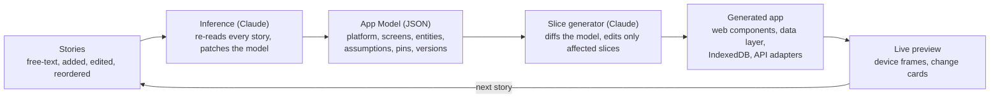

# Story to Code: PRD

Draft, 2026-10-19. Living version: [Claude Doc](https://claude.ai/code/artifact/af80869b-9c2e-4e1a-9036-372f81b3c6f4).

## Overview

Story to Code turns plain-language user stories into a running app that re-shapes itself after every story. A person types "Joe logs into an app" and sees a phone frame with a login screen within seconds. Each new or edited story makes Claude re-infer the app: its platform, screens, components, data model and integrations.

The surprise is the product. A story that changes the app's identity ("Sally is at the store", "this should be a game on the App Store") should visibly transform it, and the person should see why.

The output is real code, not a mock-up: HTML5 and vanilla JavaScript web components, built in vertical slices so every story adds a working path from UI to data.

## Goals and non-goals

The first release proves one thing: a sequence of stories reliably produces a running, coherent app that changes in ways the person can follow.

**Goals**

- A first visible app within one story, starting from a generic shell (login screen on a phone frame).
- Every story change triggers a re-inference and a fresh render, with a diff of what changed and which story caused it.
- The generated app is runnable HTML5 + vanilla JS web components with no framework or build step.
- The UI and the data model are both inferred, and both stay traceable to the stories that implied them.
- Projects can be exported as a plain folder or Git repository.

**Non-goals for v1**

- Producing App Store binaries or native Swift/Kotlin code (see Platform inference).
- Hosting or operating the generated apps in production.
- Multi-user collaborative editing of the same story set.
- Pixel-perfect visual design; wireframe fidelity first, styled later.

## Users and the core loop

The primary user is someone with an app idea who thinks in scenarios, not specs: a founder, product manager, designer or hobbyist. A secondary user is a developer who wants a working scaffold to take over.

The screen has two halves: a story list on the left and a live device preview on the right (phone, tablet, desktop or a combination, as inferred).

The loop, repeated for every story:

1. The person adds, edits, reorders or deletes a story in plain language.
2. Claude re-reads the whole story set and updates the **App Model**: platform, personas, screens, components, entities, integrations and assumptions.
3. Claude plans the smallest vertical slice that satisfies the new or changed story.
4. Claude generates or edits the affected web components and data layer.
5. The preview hot-swaps to the new app, and a change card explains what changed and why ("Added a Store entity and a store-mode screen because Sally is at the store").
6. The person reacts: accepts, pins something they want kept, or writes the next story.

The person can also pin decisions ("keep it a web app") so later stories cannot overturn them, and roll back to any earlier version.

## Worked examples

These two sequences are the acceptance scenarios for v1. Each row is one story and what the app must become after it.

**Open-ended: Joe and Sally**

| # | Story | What Claude infers | What the preview shows |
| --- | --- | --- | --- |
| 1 | Joe logs into an app. | Generic app, one persona, auth needed. Default platform: mobile. | Phone frame, login screen, empty home. |
| 2 | Joe is sitting at his desk using his desktop. | It is a web app; responsive with a desktop layout. | Phone and desktop frames side by side; desktop gets a sidebar layout. |
| 3 | Sally uses the same app and is at the store. | Second persona; a Store concept; a reason to use it at home and in store (e.g. lists or inventory). | Store entity, a store-context screen, a guess at the domain shown as an assumption the person can confirm or reject. |

**Focused: Susie's weather app**

| # | Story | What Claude infers | What the preview shows |
| --- | --- | --- | --- |
| 1 | Susie picks up her phone to check the weather. | Weather app, mobile-first. | Phone frame, weather home with placeholder data. |
| 2 | Susie checks the weather and the app shows the local weather. | Needs geolocation and a weather API; Location and Forecast entities. | Live local conditions via the browser Geolocation API and a weather service. |
| 3 | Susie wants to see the weather in Florida tomorrow. | Place search, saved locations, multi-day forecast; local stays primary. | Search, a saved-places list, a day picker; local card remains on top. |
| 4 | This app should be a game, and I want it on the App Store. | Identity shift to a game; target is iOS native distribution. | A game-shaped UI following Apple's Human Interface Guidelines, plus an App Store readiness checklist (see Platform inference). |

## Functional requirements

**Stories**

- [ ] FR-1 Add, edit, reorder, delete and disable stories in free text; no template required.
- [ ] FR-2 Accept optional structured form ("As a…, I want…, so that…") and acceptance criteria, but never require it.
- [ ] FR-3 Each story shows which screens, components and entities it produced (story-to-artifact trace).

**Inference**

- [ ] FR-4 Maintain one App Model (JSON) as the single source of truth, regenerated or patched after each story change.
- [ ] FR-5 Infer platform, personas, screens and navigation, components, entities and relationships, integrations, and non-functional needs (offline, auth, location).
- [ ] FR-6 Record every guess as an explicit assumption with a confidence level; the person can confirm, reject or pin it.
- [ ] FR-7 When a story contradicts an earlier one, prefer the newest story unless the earlier decision is pinned, and say so in the change card.

**Generation and preview**

- [ ] FR-8 Generate HTML5 + vanilla JS custom elements (Shadow DOM, no framework, no build step).
- [ ] FR-9 Render the app in device frames chosen from the inferred platforms; update in place without a page reload where possible.
- [ ] FR-10 Offer a wireframe mode (grayscale, boxes and labels) and a styled mode.
- [ ] FR-11 Generate a data layer from the entities: a typed store with IndexedDB persistence and seed data, with adapters for external APIs.
- [ ] FR-12 Mock any external service until the person supplies a key or picks a provider.

**History and export**

- [ ] FR-13 Version every App Model and code snapshot; diff and roll back between any two versions.
- [ ] FR-14 Export the app as a folder or push it to a Git repository, with the stories and App Model included.

## Architecture

Claude is the engine at two points: inferring the App Model from the stories, and generating code from changes to that model. Everything else is deterministic plumbing.

The App Model is the hinge: stories change the model, the model's diff drives the code, and the preview closes the loop back to the person.

- **Claude calls** use the Messages API with structured output (tool use) for the App Model, and prompt caching for the story set and component library.
- **Generated app** is plain files: `index.html`, one module per custom element, a `store.js` data layer, and a `manifest.json` when a PWA is inferred.
- **Preview** runs the generated app in a sandboxed iframe inside device frames, swapping modules in place on each change.

## Vertical slices and how the app evolves

Every story becomes one vertical slice: the thinnest path through UI, logic and data that makes the story true. "Susie sees the local weather" means a location service, a forecast adapter, a Forecast entity and a forecast card, all working together, not a finished UI layer waiting on a later data layer.

Rules the engine follows:

- **Model first, code second.** Claude changes the App Model, then derives the code change from the model diff. The code is never the source of truth.
- **Smallest change that satisfies the story.** Untouched slices keep their code byte for byte, so the app stays stable when the story set grows.
- **Big shifts are allowed and announced.** When a story changes the app's identity (web to game, single user to multi-role), Claude regenerates freely and the change card marks it as a pivot.
- **Components are reusable units.** One custom element per UI concept (`<weather-card>`, `<place-search>`, `<login-form>`), each with a small attribute and event API, so slices compose instead of duplicating.
- **Each slice ships with a check.** A generated acceptance test per story (Playwright-style, run in the preview) confirms the story still holds after later changes.

## Platform inference

Platform is just another inferred property of the App Model, and the preview frames follow it. The proposal for v1 is that every platform is rendered from the same web components, with native targets handled by packaging rather than by generating native code.

| Signal in a story | Inferred platform | v1 output |
| --- | --- | --- |
| None yet | Mobile-first app | Web components in a phone frame |
| Desk, desktop, laptop, office | Responsive web app | Phone and desktop frames, desktop layout |
| Offline, home screen, "install it" | Progressive Web App | Manifest, service worker, installable |
| App Store, Google Play, iPhone app | Native distribution | Apple HIG-styled UI, a Capacitor wrapper project, and an App Store readiness checklist |
| Game, play, score, levels | Game | Canvas or WebGL scene inside a web component, game loop scaffold |

For App Store stories the readiness checklist covers what Apple reviews: privacy manifest and permission strings, Sign in with Apple when other social logins exist, in-app purchase rules, minimum functionality beyond a wrapped website, icons and launch screens. Whether v1 should go further and emit SwiftUI is an open question below.

## Milestones

No dates are set yet; each milestone ends with a demo of the worked examples it unlocks.

1. **M0 Spike.** One story in, one login screen out. App Model schema v0, a single Claude call, a static preview.
2. **M1 The loop.** Story list, re-inference on every change, hot-swapped preview, change cards. Demo: Joe and Sally, stories 1 to 3.
3. **M2 Real data.** Entity-driven data layer with IndexedDB, mocked then live API adapters, geolocation. Demo: Susie, stories 1 to 3.
4. **M3 Trust and control.** Assumptions panel, pinning, version history, diff and rollback, per-story acceptance tests.
5. **M4 Platforms.** Multi-frame preview, PWA output, game scaffold, Capacitor packaging and the App Store checklist. Demo: Susie, story 4.
6. **M5 Export.** Folder and Git export with stories and App Model included.

## Risks

| Risk | Why it matters | Mitigation |
| --- | --- | --- |
| Churn feels random, not fun | People lose the thread when the app jumps without a reason | Change cards name the story behind each change; pivots are labelled; pinning and rollback |
| Regeneration breaks working slices | Later stories silently undo earlier ones | Model-diff-driven edits, untouched code kept as is, per-story acceptance tests |
| Latency per story | The magic depends on seeing the change quickly | Patch the App Model instead of regenerating it; stream the preview; cache components |
| Token cost grows with the story set | Every change re-reads all stories | Summarised App Model as context, prompt caching, only affected slices regenerated |
| Generated code is insecure or low quality | Exported apps get used for real | Lint and test gates, no secrets in generated code, sandboxed preview iframe |
| App Store expectations exceed a web wrapper | Apple rejects thin wrappers | Checklist calls this out; native output is a later decision (open question) |

## Open questions

- [ ] Native apps: is a Capacitor wrapper plus an HIG-styled web UI enough for "I want it on the App Store", or should v1 also emit SwiftUI/Kotlin? (Draft assumes the wrapper.)
- [ ] Who runs Story to Code: a hosted web app, a local tool, or a Claude Code plugin? This decides where the Claude API key lives.
- [ ] Should the tool itself be built with the same stack (vanilla web components), so it can dogfood its own output?
- [ ] How much randomness is wanted? A "wild" vs "steady" dial could set how freely Claude reinterprets the app.
- [ ] Where do real API keys come from (weather, maps) and which providers are the defaults?
- [ ] Is there a backend in generated apps (auth, shared data between Joe and Sally), or are they client-only with local persistence in v1?
- [ ] Should stories be able to reference each other or personas defined once ("Joe is a store manager")?
